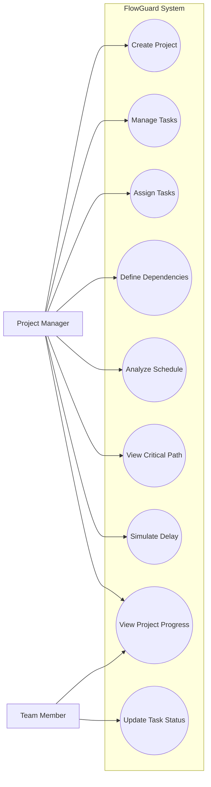
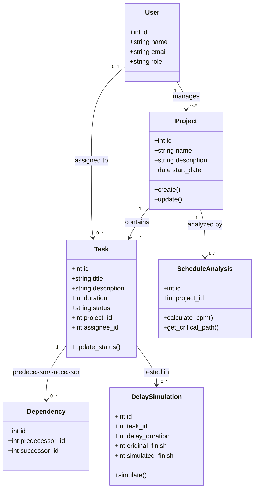
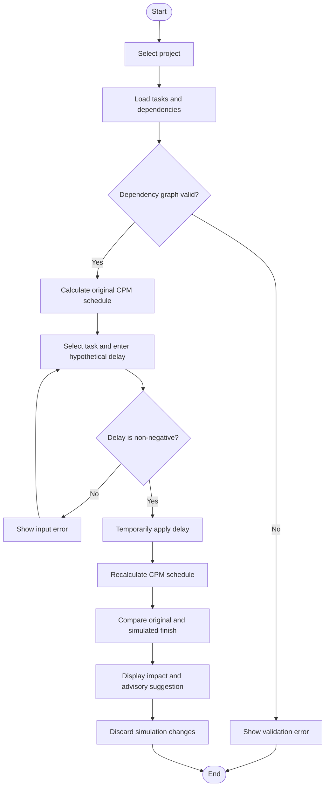
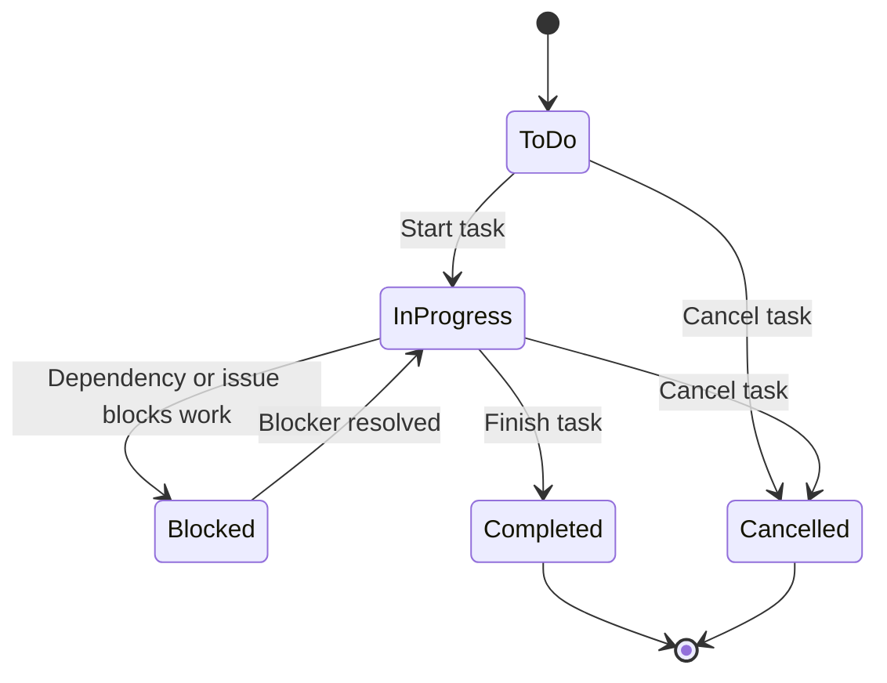

# FlowGuard – Software Design Diagrams

The diagrams below describe the proposed MVP design. They can be rendered directly by GitHub because they use Mermaid.

## 1. Use Case Diagram

## 2. Class Diagram

## 3. Activity Diagram – Delay Simulation

## 4. State Diagram – Task

## 5. Design notes
- A project contains multiple tasks.
- Dependencies connect tasks in the same project.
- The dependency graph must not contain cycles.
- CPM analysis is calculated from task durations and dependencies.
- Delay simulation must not overwrite the saved baseline plan.
- The diagrams represent the proposed design and should be updated if implementation decisions change.
